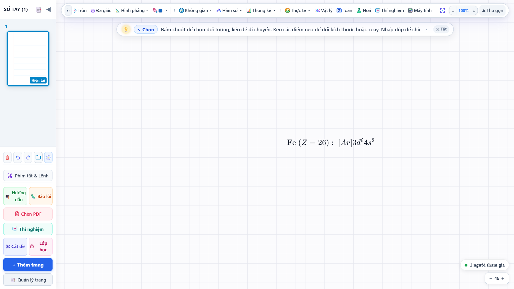

<div align="center">
  
  <h1>PhysBoard v1.3.1</h1>
  <p>
    <strong>Bảng trắng tương tác dạy Toán · Vật lý · Hoá học THPT (Chương trình GDPT 2018)</strong><br />
    <em>Chạy mượt mà trên Windows (<code>.exe</code>), Android (<code>.apk</code>) &amp; Trình duyệt — Lưu trữ 100% Offline</em>
  </p>

  <p>
    <a href="https://github.com/NeoGao-com/PhysBoard/releases/latest">
      
    </a>
    &nbsp;
    <a href="https://github.com/NeoGao-com/PhysBoard/releases/latest">
      
    </a>
    &nbsp;
    <a href="https://github.com/NeoGao-com/PhysBoard/issues">
      
    </a>
  </p>

  <p>
    <code>Next.js 16</code> · <code>React 19</code> · <code>Tailwind CSS v4</code> · <code>KaTeX &amp; MathLive</code> · <code>Tauri v2 (Rust)</code> · <code>Capacitor Android</code>
  </p>

  <br />
  
</div>

---

## Mục lục

- [Tại sao chọn PhysBoard?](#tại-sao-chọn-physboard)
- [1. Bảng trắng Vector, Bút Stylus, Hình học 2D/3D & Đồ thị](#1-bảng-trắng-vector-bút-stylus-hình-học-2d3d--đồ-thị)
- [2. Bộ 3 Ngăn kéo Công thức chuẩn GDPT 2018 (Chèn LaTeX 1 chạm)](#2-bộ-3-ngăn-kéo-công-thức-chuẩn-gdpt-2018-chèn-latex-1-chạm)
  - [2.1. Ngăn kéo Công thức Toán 10–11–12](#21-ngăn-kéo-công-thức-toán-101112)
  - [2.2. Ngăn kéo Vật lý, Hằng số CODATA & Đổi đơn vị](#22-ngăn-kéo-vật-lý-hằng-số-codata--đổi-đơn-vị)
  - [2.3. Ngăn kéo Hoá học & Bảng Tuần Hoàn 118 nguyên tố tương tác](#23-ngăn-kéo-hoá-học--bảng-tuần-hoàn-118-nguyên-tố-tương-tác)
- [3. Thí nghiệm Mô phỏng PhET Online & File HTML Offline toàn màn hình](#3-thí-nghiệm-mô-phỏng-phet-online--file-html-offline-toàn-màn-hình)
- [4. Máy tính khoa học tích hợp (kiểu Casio fx-580VN X)](#4-máy-tính-khoa-học-tích-hợp-kiểu-casio-fx-580vn-x)
- [5. Cắt câu hỏi từ PDF / Ảnh chụp đề thi & Quản lý Sổ tay](#5-cắt-câu-hỏi-từ-pdf--ảnh-chụp-đề-thi--quản-lý-sổ-tay)
- [6. Công cụ Lớp học (Đếm ngược & Gọi tên ngẫu nhiên)](#6-công-cụ-lớp-học-đếm-ngược--gọi-tên-ngẫu-nhiên)
- [7. Cài đặt chuyên sâu, Sao lưu toàn bộ Sổ tay & Tự động cập nhật](#7-cài-đặt-chuyên-sâu-sao-lưu-toàn-bộ-sổ-tay--tự-động-cập-nhật)
- [8. Báo lỗi & Phản hồi trực tiếp ngay trong ứng dụng](#8-báo-lỗi--phản-hồi-trực-tiếp-ngay-trong-ứng-dụng)
- [9. Cấu trúc dự án & Hướng dẫn cho Developer](#9-cấu-trúc-dự-án--hướng-dẫn-cho-developer)

---

## Tại sao chọn PhysBoard?

Giáo viên dạy **Toán – Vật lý – Hoá học** thường phải mở cùng lúc nhiều ứng dụng rời rạc: một phần mềm viết bảng, một trình duyệt để chạy thí nghiệm PhET, một phần mềm giả lập máy tính bỏ tay, cùng các file PDF tra cứu công thức và bảng tuần hoàn.

**PhysBoard** hợp nhất toàn bộ quy trình giảng dạy vào **một không gian bảng trắng vector duy nhất**, thiết kế gọn gàng, chạy hoàn toàn **Offline** (lưu dữ liệu cục bộ bằng IndexedDB/Yjs) và tối ưu cho cả **chuột/bảng vẽ Wacom trên Windows** lẫn **bút cảm ứng (S Pen / Stylus) trên máy tính bảng Android**.

---

## 1. Bảng trắng Vector, Bút Stylus, Hình học 2D/3D & Đồ thị

Toàn bộ nét viết, công thức và hình vẽ trên PhysBoard đều là **vector sắc nét**, phóng to không vỡ hình:

- **Hệ thống bút viết đa dạng (`Stylus-ready`):**
  - Bút bi, Bút máy thư pháp (`ink:fountain` nhận lực nhấn), Bút chì, Bút dạ quang (highlight), Bút nét đứt.
  - **Bút chỉ Laser:** Chế độ chấm đỏ hoặc vệt sáng tự mờ dần khi giảng bài.
  - **Ink-to-Shape:** Vẽ tay và giữ yên `0.34s` để tự động nắn thành đoạn thẳng, đường tròn, tam giác chuẩn xác.
  - **Chế độ Pen-Only (Chỉ viết bằng bút Stylus):** Tì tay lên màn hình tablet không bị lem mực, ngón tay chỉ dùng để cuộn/zoom.
- **Hình học phẳng 2D:** Vẽ điểm, đoạn/đường/tia/vectơ, đường tròn, đa giác; dựng hình tự động (trung điểm, đường cao, trọng tâm, trực tâm, phân giác, tiếp tuyến, trung trực); gắn ký hiệu bằng nhau, vuông góc và tô màu miền phẳng.
- **Hình học không gian 3D & Hệ trục `Oxyz`:** Tạo nhanh hình hộp, lập phương, lăng trụ, hình chóp, chóp cụt, hình trụ, nón, cầu; xoay quỹ đạo góc nhìn 3D trực tiếp, tìm giao tuyến và mặt phẳng thiết diện.
- **Đồ thị hàm số & Thống kê:** Hệ trục `Oxy`, vẽ đồ thị hàm số/bất phương trình hỗ trợ **thanh trượt tham số ($a, b, m$)**, lập bảng biến thiên, cây xác suất Bayes, biểu đồ thống kê & biểu đồ Venn.
- **Khoá/Mở khoá đối tượng linh hoạt:** Khoá riêng từng đề bài/hình nền vào trang để viết đè lên không bị xê dịch nhầm; nhấp đúp hoặc bấm nút **🔓 Mở khoá** góc dưới trái khi cần chỉnh sửa lại.

---

## 2. Bộ 3 Ngăn kéo Công thức chuẩn GDPT 2018 (Chèn LaTeX 1 chạm)

Mỗi môn học có một ngăn kéo tra cứu riêng biệt, hỗ trợ **tìm kiếm tiếng Việt không dấu** và nút **+ Chèn / + Chèn bảng** đưa trực tiếp công thức LaTeX (`KaTeX`) sắc nét lên bảng trắng.

### 2.1. Ngăn kéo Công thức Toán 10–11–12

Tổng hợp đầy đủ các nhóm kiến thức trọng tâm: **Đại số & Phương trình** (Hằng đẳng thức, Vi-ét, BĐT Cô-si/Bunyakovsky, Mũ & Logarit), **Lượng giác**, **Giải tích** (Đạo hàm, Nguyên hàm, Tích phân), **Hình học 2D & `Oxy`**, **Không gian & `Oxyz`**, **Tổ hợp & Xác suất**.

<div align="center">
  
</div>

---

### 2.2. Ngăn kéo Vật lý, Hằng số CODATA & Đổi đơn vị

Gồm 3 thẻ chuyên dụng cho dạy Vật lý THPT:
1. **Bảng Công thức SGK 10–11–12:** Phân loại rõ theo *Cơ học, Dao động & Sóng, Điện & Từ, Nhiệt & Khí lý tưởng, Quang & Hạt nhân*.
2. **Hằng số Vật lý (CODATA):** Chèn nhanh $g, c, h, e, N_A, k_B, R, G\dots$ kèm đơn vị chuẩn SI.
3. **Đổi đơn vị Vật lý nhanh:** Quy đổi trực tiếp kèm công thức hệ số (ví dụ `1 km/h = 1/3,6 m/s`, `1 eV = 1,6×10⁻¹⁹ J`) để học sinh hiểu bản chất.

<div align="center">
  
</div>

---

### 2.3. Ngăn kéo Hoá học & Bảng Tuần Hoàn 118 nguyên tố tương tác

- **6 nhóm Công thức Hoá học:** Mol & Dung dịch, Nguyên tử & Nhiệt hoá, Cân bằng & pH, Điện hoá & OXH-K, Hoá hữu cơ, Bảo toàn & Giải nhanh.
- **Bảng Tuần Hoàn 118 nguyên tố tương tác:**
  - Lọc theo nhóm nguyên tố hoặc tìm theo ký hiệu / tên tiếng Việt / số hiệu $Z$ (vd: `Fe`, `Sắt`, `26`).
  - Nhấn vào bất kỳ nguyên tố nào để xem nguyên tử khối $M$, chu kỳ, độ âm điện, số oxi hoá và **cấu hình electron**.
  - Bấm **+ Chèn cấu hình e** để đưa ngay `Fe (Z = 26): [Ar] 3d⁶ 4s²` lên bảng trắng.

<div align="center">
  
</div>

---

## 3. Thí nghiệm Mô phỏng PhET Online & File HTML Offline toàn màn hình

Thay vì nhúng khung nhỏ chật hẹp, PhysBoard chạy thí nghiệm như một **cửa sổ toàn màn hình độc lập ngay trong app**:

- **Kho 28+ bài PhET Online chọn lọc & dán link bất kỳ:** Tự động chuyển sang gói đa ngôn ngữ `_all.html?locale=vi` (hiển thị tiếng Việt, tự fallback tiếng Anh nếu bài chưa có bản dịch).
- **Kho File `.html` Offline (IndexedDB + Blob URL):** Tải sẵn file HTML5 đơn lẻ từ [phet.colorado.edu](https://phet.colorado.edu/) về máy, nhập vào app để lưu lâu dài — giảng dạy **100% không cần mạng**, tiết kiệm RAM trên máy tính bảng Android.
- **Chuyển đổi tức thì Bảng trắng ↔ Thí nghiệm:** Bấm **─ Về bảng trắng** để giải bài tập trong khi thí nghiệm vẫn giữ nguyên trạng thái chạy ngầm; bấm nút nổi ở góc dưới phải để quay lại đúng mô phỏng đang mở.
- **Lớp kính vẽ chú thích trực tiếp (`✏ Vẽ chú thích`):** Khoanh vùng, vẽ mũi tên, ghi chú ngay đè lên màn hình thí nghiệm đang chạy.

<div align="center">
  
</div>

---

## 4. Máy tính khoa học tích hợp (kiểu Casio fx-580VN X)

Mở cửa sổ nổi máy tính cầm tay ngay trên bảng trắng để hướng dẫn học sinh bấm máy trực quan từng phím:
- Giao diện phím bấm quen thuộc chuẩn **fx-580VN X**, màn hình **HiDPI Vector LCD** sắc nét ở mọi mức zoom.
- Hỗ trợ nhập biểu thức tự nhiên (phân số, căn thức, lũy thừa, logarit, lượng giác), giải phương trình, tính đạo hàm/tích phân số, lưu biến nhớ `STO` và kéo thả tự do vị trí trên bảng.

<div align="center">
  
</div>

---

## 5. Cắt câu hỏi từ PDF / Ảnh chụp đề thi & Quản lý Sổ tay

- **✂ Cắt đề thông minh (`Cắt đề`):** Kéo thả file **PDF / Ảnh đề thi** hoặc chụp màn hình rồi nhấn **`Ctrl+V`** để dán trực tiếp → khoanh vùng đúng 1 câu hỏi → bấm **✂ Cắt & Ghim lên bảng** (tự động khoá đề bài vào trang để viết lời giải đè lên không bị xê dịch). Có nút **Cắt & Cắt tiếp câu khác** giúp cắt liên tiếp nhiều câu cực nhanh.
- **Chèn PDF nhiều trang & Quản lý Sổ tay:** Nhập toàn bộ file PDF làm nhiều trang bảng, thêm/xoá/sắp xếp thứ tự trang ở thanh Sổ tay bên trái, tuỳ chọn khổ **Bảng vô hạn** hoặc **Trang A4** in ấn, đổi nền giấy (ô ly, chấm bi, kẻ ngang, bảng đen/xanh).
- **Xuất tài liệu:** Xuất bài giảng ra **PNG** hoặc **PDF** nhiều trang để gửi lại cho học sinh ôn tập.

<div align="center">
  
</div>

---

## 6. Công cụ Lớp học (Đếm ngược & Gọi tên ngẫu nhiên)

Tích hợp sẵn ngay trên thanh bên mà không cần mở thêm web ngoài:
- **⏱ Đồng hồ đếm ngược:** Chọn nhanh các mốc `1p`, `3p`, `5p`, `10p`, `15p` hoặc tuỳ chỉnh thời gian làm bài trắc nghiệm, có thanh tiến trình trực quan và chuông báo khi hết giờ.
- **🎲 Gọi tên ngẫu nhiên:** Nhập danh sách lớp một lần (tự lưu), bấm quay để gọi ngẫu nhiên học sinh lên bảng/trả lời câu hỏi **không bị trùng lặp** trong cùng lượt.

<div align="center">
  
</div>

---

## 7. Cài đặt chuyên sâu, Sao lưu toàn bộ Sổ tay & Tự động cập nhật

Hộp thoại **Cài Đặt Hệ Thống** cho phép cá nhân hoá toàn bộ không gian dạy học:
- **Tự động cập nhật trong app:** Kiểm tra phiên bản mới từ GitHub Releases, tải ngầm có hiển thị `%` tiến trình và cài đặt trực tiếp trên cả **Windows (`.exe`)** lẫn **Android (`.apk`)**.
- **Ẩn/Hiện Công cụ & Bố cục Mô-đun (Lego):** Tắt bớt các nút không dùng (ví dụ dạy Toán có thể ẩn Hoá/Vật lý) để thanh công cụ gọn nhẹ tối đa.
- **💾 Sao lưu & Khôi phục toàn bộ Sổ tay (`.physbackup.json`):** Xuất toàn bộ các sổ tay, trang viết, hình vẽ và PDF ra 1 file dự phòng duy nhất để chuyển dữ liệu giữa máy tính và máy tính bảng.
- **Bảng lệnh nhanh (`Ctrl+K`):** Tìm nhanh mọi công cụ và gán phím tắt theo thói quen cá nhân.

<div align="center">
  
</div>

---

## 8. Báo lỗi & Phản hồi trực tiếp ngay trong ứng dụng

Khi gặp sự cố hoặc muốn đề xuất tính năng mới, người dùng chỉ cần bấm nút **🐛 Báo lỗi** ngay trên thanh bên trái:
- Chọn phân loại (**Báo lỗi / Góp ý tính năng / Giao diện**), nhập mô tả ngắn gọn.
- Tự động đính kèm phiên bản ứng dụng (`v1.3.1`), hệ điều hành, kích thước màn hình và trình duyệt/WebView để tác giả tái hiện và sửa lỗi nhanh hơn.
- Gửi 1 chạm qua **GitHub Issues**, **Email**, hoặc **Copy báo cáo** gửi qua Zalo/Messenger.

<div align="center">
  
</div>

---

## 9. Cấu trúc dự án & Hướng dẫn cho Developer

### Cấu trúc thư mục chính

```text
├── assets/                   # Logo gốc & adaptive icon đa nền tảng
├── docs/screenshots/         # Ảnh chụp màn hình thực tế cho tài liệu giới thiệu
├── src-tauri/                # Nhân Rust & Tauri v2 đóng gói Windows (.exe) + Auto-Updater
├── android/                  # Dự án Capacitor Android (.apk) + AppUpdaterPlugin.java
├── src/
│   ├── app/                  # Next.js 16 App Router (Static Export -> out/)
│   ├── components/
│   │   └── sites/mathvera/   # Whiteboard, Toolbar, Drawers (Toán/Lý/Hoá), PeriodicTable,
│   │                         # SimLauncher, FullscreenSimOverlay, CasioFx580Panel,
│   │                         # QuestionCropModal, ClassroomToolsWidget, SettingsModal
│   ├── hooks/                # Điều hướng canvas, Undo/Redo, Yjs IndexedDB Offline
│   ├── lib/                  # Kho công thức Toán/Lý/Hoá, 118 nguyên tố, Sim DB, Giải Hình 2D/3D, Backup/Export
│   └── types/                # Định nghĩa TypeScript
├── tests/e2e/                # Bộ kiểm thử tự động Playwright E2E
├── capacitor.config.json     # Cấu hình Capacitor (com.physboard.app)
└── package.json              # Scripts dev, check, build:exe, build:android
```

### Cài đặt & Chạy phát triển

Yêu cầu: **Node.js >= 20** (khuyến nghị **Node 24**).

```bash
# 1. Cài đặt thư viện
npm install

# 2. Chạy môi trường phát triển tại http://localhost:3000
npm run dev

# 3. Kiểm tra ESLint + TypeScript + Build Static Export (out/)
npm run check
```

### Đóng gói đa nền tảng

- **Windows (`.exe`) với Tauri v2 (Rust):**
  ```bash
  npm run tauri:dev   # Chạy thử cửa sổ Desktop Native
  npm run build:exe   # Đóng gói bộ cài NSIS Installer (.exe)
  ```
- **Android (`.apk`) với Capacitor:**
  ```bash
  npm run build:android   # Build web (out/) + đồng bộ sang android/
  npx cap open android    # Mở Android Studio để ký & xuất APK
  ```

---

<div align="center">
  <sub>Phát hành theo giấy phép MIT · Phát triển tại <a href="https://github.com/NeoGao-com/PhysBoard">NeoGao-com/PhysBoard</a></sub>
</div>
