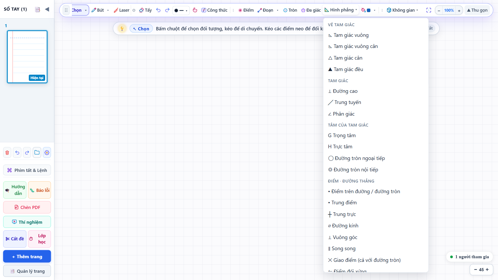
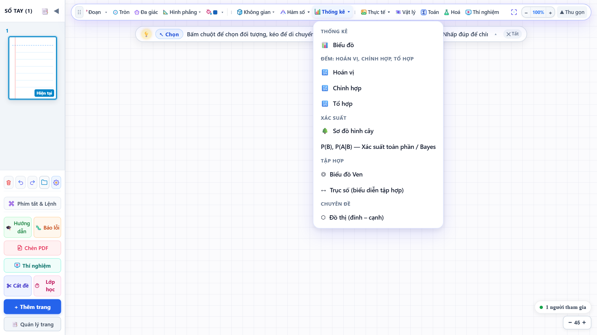
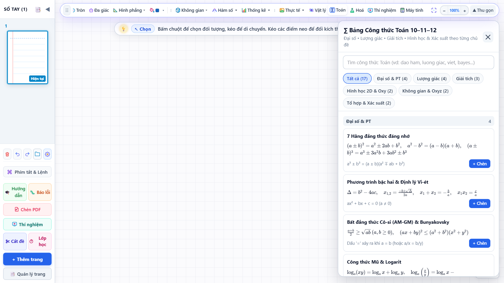
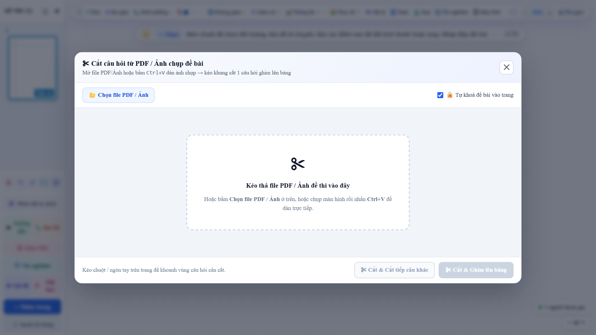
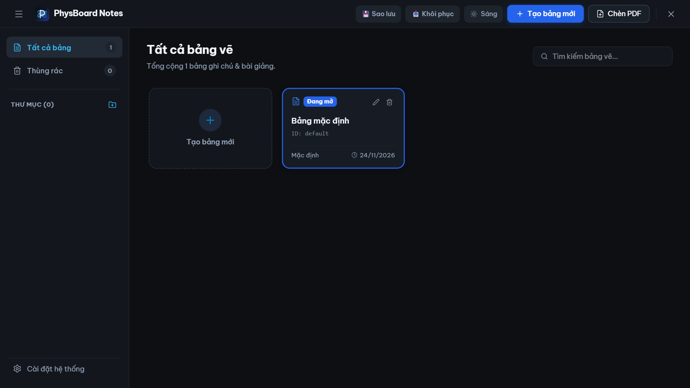

  
  <h1>PhysBoard v1.3.1</h1>
  

    <strong>Bảng trắng tương tác toàn diện dạy Toán · Vật lý · Hoá học THPT (GDPT 2018)</strong> 
    <em>Chạy mượt mà trên Windows (<code>.exe</code>), Android (<code>.apk</code>) &amp; Trình duyệt — Hoạt động 100% Offline, không cần đăng nhập</em>
  

  

    
    &nbsp;
    
    &nbsp;
    
  

   
  

---

## Mục lục

- [PhysBoard giải quyết vấn đề gì?](#physboard-giải-quyết-vấn-đề-gì)
- [1. Bảng viết Vector, Hệ thống Bút Stylus & Bút chỉ Laser](#1-bảng-viết-vector-hệ-thống-bút-stylus--bút-chỉ-laser)
- [2. Hình học Phẳng 2D & Dựng hình Tự động](#2-hình-học-phẳng-2d--dựng-hình-tự-động)
- [3. Hình học Không gian 3D & Hệ trục Oxyz tương tác](#3-hình-học-không-gian-3d--hệ-trục-oxyz-tương-tác)
- [4. Hàm số, Đồ thị, Bảng biến thiên & Đường tròn lượng giác](#4-hàm-số-đồ-thị-bảng-biến-thiên--đường-tròn-lượng-giác)
- [5. Thống kê, Tổ hợp – Xác suất, Cây Bayes & Biểu đồ Venn](#5-thống-kê-tổ-hợp--xác-suất-cây-bayes--biểu-đồ-venn)
- [6. Thư viện Vật thể Thực tế (Bài toán ứng dụng)](#6-thư-viện-vật-thể-thực-tế-bài-toán-ứng-dụng)
- [7. Bộ 3 Ngăn kéo Công thức chuẩn GDPT 2018 (Chèn LaTeX 1 chạm)](#7-bộ-3-ngăn-kéo-công-thức-chuẩn-gdpt-2018-chèn-latex-1-chạm)
  - [7.1. Công thức Toán học 10–11–12](#71-công-thức-toán-học-101112)
  - [7.2. Công thức Vật lý, Hằng số CODATA & Bộ đổi đơn vị](#72-công-thức-vật-lý-hằng-số-codata--bộ-đổi-đơn-vị)
  - [7.3. Công thức Hoá học & Bảng Tuần Hoàn 118 nguyên tố tương tác](#73-công-thức-hoá-học--bảng-tuần-hoàn-118-nguyên-tố-tương-tác)
- [8. Thí nghiệm Mô phỏng PhET Online & File HTML Offline Toàn màn hình](#8-thí-nghiệm-mô-phỏng-phet-online--file-html-offline-toàn-màn-hình)
- [9. Máy tính khoa học giả lập kiểu Casio fx-580VN X](#9-máy-tính-khoa-học-giả-lập-kiểu-casio-fx-580vn-x)
- [10. Cắt đề thi từ PDF / Ảnh chụp & Quản lý Sổ tay (PhysBoard Notes)](#10-cắt-đề-thi-từ-pdf--ảnh-chụp--quản-lý-sổ-tay-physboard-notes)
- [11. Công cụ Lớp học (Đếm ngược & Gọi tên ngẫu nhiên)](#11-công-cụ-lớp-học-đếm-ngược--gọi-tên-ngẫu-nhiên)
- [12. Phím tắt cá nhân hoá (Ctrl+K), Cài đặt chuyên sâu, Tự cập nhật & Báo lỗi](#12-phím-tắt-cá-nhân-hoá-ctrlk-cài-đặt-chuyên-sâu-tự-cập-nhật--báo-lỗi)

---

## PhysBoard giải quyết vấn đề gì?

Khi dạy **Toán – Vật lý – Hoá học** trên lớp hoặc dạy trực tuyến, giáo viên thường phải mở xen kẽ rất nhiều phần mềm rời rạc: một bảng trắng để viết, GeoGebra để dựng hình, trình duyệt web để chạy thí nghiệm PhET, phần mềm giả lập máy tính bỏ tay và file PDF tra cứu công thức / bảng tuần hoàn.

**PhysBoard** gom toàn bộ hệ sinh thái giảng dạy đó vào **một ứng dụng duy nhất**:
- **Sắc nét tuyệt đối:** Mọi nét bút, công thức toán học (LaTeX), hình học 2D/3D đều lưu dưới dạng **vector**, phóng to thoải mái không bao giờ vỡ hạt.
- **100% Offline & Riêng tư:** Không yêu cầu tạo tài khoản, không phụ thuộc Internet khi lên lớp; toàn bộ sổ tay, PDF và thí nghiệm HTML lưu an toàn ngay trên thiết bị.
- **Tối ưu đa thiết bị:** Thao tác mượt bằng chuột / bảng vẽ Wacom trên **Windows (`.exe`)** và hỗ trợ bút cảm ứng (**S Pen / Stylus**) có chống tì tay trên **máy tính bảng Android (`.apk`)**.

---

## 1. Bảng viết Vector, Hệ thống Bút Stylus & Bút chỉ Laser

Không gian viết bảng được tối ưu như một cuốn vở thực thụ nhưng mang sức mạnh kỹ thuật số:

- **Nhiều loại đầu bút chuyên biệt:**
  - **Bút bi tự do (`P`):** Nét mực trơn mượt, tự động làm mịn đường cong khi viết nhanh.
  - **Bút máy thư pháp (`B`):** Nét thanh nét đậm theo góc nghiêng và lực nhấn của bút Stylus / bảng vẽ điện tử.
  - **Bút chì, Bút dạ quang (Highlighter) & Bút nét đứt:** Đánh dấu dữ kiện quan trọng trong đề bài hoặc vẽ nhanh đường gióng, nét khuất.
- **Tự động nắn hình thông minh (`Ink-to-Shape`):** Khi đang dùng bút viết tay, chỉ cần vẽ phác một đoạn thẳng, hình tròn, tam giác rồi **giữ yên đầu bút khoảng `0,34 giây`**, PhysBoard sẽ tự động nắn thành hình hình học phẳng chuẩn xác.
- **Bút chỉ Laser trình chiếu:** Hỗ trợ 2 kiểu hiển thị — **chấm sáng Laser** hoặc **vệt mực phát sáng tự mờ dần sau vài giây**, giúp tập trung ánh nhìn của học sinh mà không làm bẩn bảng viết.
- **Chế độ Chỉ viết bằng bút Stylus (`Pen-Only Mode`):** Dành riêng cho máy tính bảng Android/Windows cảm ứng — khi bật, tì lòng bàn tay thoải mái lên màn hình không bị lem mực, ngón tay chỉ dùng để kéo bảng và phóng to/thu nhỏ.
- **Trình gõ Công thức Toán trực quan (`f(x) Công thức`):** Hỗ trợ nhập công thức trực tiếp bằng bàn phím Toán học ảo hoặc gõ LaTeX; từ mỗi công thức vừa gõ, giáo viên có thể bấm nhanh 4 nút hành động: **Giải phương trình**, **Vẽ đồ thị**, **Lập bảng biến thiên** hoặc **Tô miền bất phương trình**.
- **Khoá & Mở khoá từng đối tượng:** Chọn đề bài, ảnh nền hoặc hình vẽ mẫu → bấm **🔒 Khóa vào trang** để tránh xê dịch nhầm khi viết lời giải đè lên; khi cần chỉnh lại chỉ cần nhấp đúp hoặc bấm nút **🔓 Mở khoá** ở góc dưới trái.

---

## 2. Hình học Phẳng 2D & Dựng hình Tự động

Thanh công cụ **Hình phẳng** cung cấp đầy đủ các phép dựng hình chuẩn SGK Toán THCS–THPT — mọi điểm, đường và ký hiệu đều liên kết động với nhau:

- **Vẽ nhanh các loại tam giác đặc biệt:** Tam giác vuông, tam giác vuông cân, tam giác cân, tam giác đều kèm tự động đánh tên đỉnh (`A, B, C...`).
- **Đường & Tâm đặc biệt trong tam giác:** Dựng 1 chạm **Đường cao**, **Trung tuyến**, **Phân giác**, **Trọng tâm (`G`)**, **Trực tâm (`H`)**, **Đường tròn ngoại tiếp** và **Đường tròn nội tiếp**.
- **Quan hệ Điểm – Đường thẳng – Đường tròn:** Đặt điểm ràng buộc trên đường/đường tròn, lấy **Trung điểm**, dựng đường **Trung trực**, **Đường kính**, đường **Vuông góc**, đường **Song song**, tìm **Giao điểm** (kể cả giao với đường tròn), lấy **Điểm đối xứng**, vẽ **Tiếp tuyến** và **Tô màu miền phẳng (`Flood Fill`)**.
- **Ký hiệu hình học chuẩn mực:** Tự động gắn ký hiệu góc vuông, ký hiệu đoạn bằng nhau, góc bằng nhau và đo độ dài / số đo góc trực tiếp trên hình.

  

---

## 3. Hình học Không gian 3D & Hệ trục Oxyz tương tác

Dạy Hình học Không gian 11–12 trở nên trực quan vượt trội mà không cần vẽ tay từng nét đứt:

- **Thư viện Khối đa diện & Khối tròn xoay:** Tạo tức thì **Hình hộp chữ nhật**, **Lập phương**, **Lăng trụ** *(tam giác, ngũ giác, lục giác)*, **Hình chóp** *(tam giác, tứ giác, ngũ giác, lục giác)*, **Chóp cụt**, **Hình trụ**, **Hình nón**, **Hình cầu** và **Hệ trục toạ độ không gian `Oxyz`**.
- **Tự động xử lý nét khuất (nét đứt) & Xoay 3D trực tiếp:** Thanh xoay quỹ đạo **OrbitBar** cho phép xoay khối 3D theo mọi góc nhìn ngay trên bảng trắng; các cạnh bị che khuất tự động chuyển thành nét đứt đúng quy tắc hình học không gian.
- **Công cụ Dựng hình trong không gian:**
  - Lấy điểm trên cạnh/đường, lấy trung điểm, tìm trọng tâm tam giác.
  - Tìm **Giao điểm hai đường thẳng (đồng phẳng)**, **Giao điểm đường thẳng – mặt phẳng**, **Giao tuyến của hai mặt phẳng**.
  - Dựng đường song song, đường vuông góc từ điểm đến đường thẳng, **dựng Mặt phẳng thiết diện**, tô màu mặt phẳng và trải phẳng / đo độ dài cạnh.

  

---

## 4. Hàm số, Đồ thị, Bảng biến thiên & Đường tròn lượng giác

Nhóm công cụ **Hàm số** giúp tiết kiệm hàng chục phút vẽ bảng cho các chuyên đề Đại số & Giải tích:

- **Hệ trục toạ độ `Oxy` & Các đường Cônic:** Chèn nhanh hệ trục `Oxy` có chia vạch chuẩn và vẽ chính xác các đường **Elip**, **Parabol**, **Hypebol**.
- **Vẽ đồ thị hàm số & Thanh trượt tham số:** Nhập bất kỳ hàm số nào (bậc nhất, bậc hai, bậc ba, trùng phương, phân thức, mũ/logarit, lượng giác...) để vẽ lên hệ trục `Oxy`; hỗ trợ **thanh trượt tham số ($a, b, m$)** giúp học sinh quan sát sự biến thiên và tương giao đồ thị theo thời gian thực.
- **Lập Bảng biến thiên & Bảng xét dấu tự động:**
  - **Bảng biến thiên lập từ hàm số:** Tự tính đạo hàm, tìm cực trị, giới hạn vô cực và vẽ mũi tên lên/xuống chuẩn trình bày bài thi THPT.
  - **Bảng xét dấu lập từ biểu thức:** Tự phân tích nghiệm và điền dấu `+ / -` trên từng khoảng.
  - **Bảng biến thiên trống:** Tạo khung bảng sẵn để giáo viên tự viết tay cùng học sinh.
- **Đường tròn lượng giác:** Chèn nhanh đường tròn lượng giác chuẩn với các góc đặc biệt ($\frac{\pi}{6}, \frac{\pi}{4}, \frac{\pi}{3}, \frac{\pi}{2}\dots$) phục vụ giảng dạy Lượng giác 11 và Dao động điều hoà Vật lý 11.

  

---

## 5. Thống kê, Tổ hợp – Xác suất, Cây Bayes & Biểu đồ Venn

Đáp ứng trọn vẹn các nội dung mới của chương trình **Toán THPT GDPT 2018**:

- **Biểu đồ thống kê trực quan:** Vẽ nhanh biểu đồ cột, đường, tròn, biểu đồ tần số ghép nhóm để phân tích mẫu số liệu.
- **Đếm — Hoán vị, Chỉnh hợp, Tổ hợp:** Công cụ minh hoạ và tính nhanh $P_n, A_n^k, C_n^k$.
- **Xác suất hiện đại:**
  - **Sơ đồ hình cây:** Dựng nhánh biến cố kèm xác suất từng nhánh rõ ràng.
  - **Công thức Xác suất toàn phần & Công thức Bayes ($P(B), P(A|B)$):** Trình bày trực quan từng bước tính xác suất có điều kiện (chương trình Toán 12 mới).
- **Tập hợp & Chuyên đề:** Vẽ nhanh **Biểu đồ Venn**, **Trục số biểu diễn khoảng/đoạn tập hợp** (giao, hợp, hiệu) và **Đồ thị đỉnh – cạnh** (Lý thuyết đồ thị — Chuyên đề Toán 11).

  

---

## 6. Thư viện Vật thể Thực tế (Bài toán ứng dụng)

Trong chương trình mới, bài toán thực tế (tính chiều cao toà nhà, khoảng cách hai con thuyền, góc nâng máy bay, bóng cây dưới ánh mặt trời, cái thang tựa tường...) xuất hiện rất nhiều.

Thay vì phải vẽ tay mất thời gian, menu **Thực tế** cho phép chèn 1 chạm các vật thể minh hoạ trực quan (**Cây, Người, Toà nhà, Cột, Cái thang, Thuyền, Máy bay, Mặt trời...** kèm công cụ **tìm thêm vật thể** và **trang trí đoạn đo kích thước, mặt đất, mặt nước**) để gắn trực tiếp vào hình vẽ tam giác/lượng giác.

  

---

## 7. Bộ 3 Ngăn kéo Công thức chuẩn GDPT 2018 (Chèn LaTeX 1 chạm)

Mỗi môn học có một ngăn kéo tra cứu riêng biệt, hỗ trợ **tìm kiếm tiếng Việt không dấu** (ví dụ gõ `dao ham`, `newton`, `nong do`...) và nút **+ Chèn / + Chèn bảng** đưa ngay công thức LaTeX (`KaTeX`) sắc nét lên bảng trắng.

### 7.1. Công thức Toán học 10–11–12

Phân loại khoa học theo 6 nhóm lớn: **Đại số & PT** (7 hằng đẳng thức, PT bậc hai & Vi-ét, BĐT Cô-si & Bunyakovsky, Mũ & Logarit), **Lượng giác**, **Giải tích** (Đạo hàm, Nguyên hàm, Tích phân), **Hình học 2D & `Oxy`**, **Không gian & `Oxyz`**, **Tổ hợp & Xác suất**.

  

---

### 7.2. Công thức Vật lý, Hằng số CODATA & Bộ đổi đơn vị

Tích hợp 3 thẻ chuyên sâu trong cùng ngăn kéo **Vật lý**:
1. **Bảng Công thức SGK 10–11–12:** Chia rõ theo *Cơ học, Dao động & Sóng, Điện & Từ, Nhiệt & Khí lý tưởng, Quang & Hạt nhân* — mỗi công thức đều có chú thích đơn vị đi kèm.
2. **Bảng Hằng số Vật lý (CODATA):** Chèn nhanh 1 chạm các hằng số chuẩn ($g, c, h, e, N_A, k_B, R, G, m_e, m_p\dots$).
3. **Bộ Đổi đơn vị Vật lý nhanh:** Quy đổi tốc độ, năng lượng, áp suất, nhiệt độ, chiều dài, điện tích... **hiển thị rõ công thức hệ số quy đổi** (vd: `1 km/h = 1/3,6 m/s`, `1 eV = 1,6×10⁻¹⁹ J`) để giáo viên giảng giải trực tiếp cho học sinh.

  

---

### 7.3. Công thức Hoá học & Bảng Tuần Hoàn 118 nguyên tố tương tác

- **6 nhóm Công thức Hoá học:** *Mol & Dung dịch*, *Nguyên tử & Nhiệt hoá*, *Cân bằng & pH*, *Điện hoá & OXH-K*, *Hoá hữu cơ*, *Bảo toàn & Giải nhanh*.
- **Bảng Tuần Hoàn 118 nguyên tố tương tác trực quan:**
  - Phân màu rõ từng nhóm nguyên tố, hỗ trợ lọc theo nhóm và tìm nhanh bằng ký hiệu, tên tiếng Việt hoặc số hiệu nguyên tử $Z$ (vd: `Fe`, `Sắt`, `26`).
  - Nhấn vào bất kỳ nguyên tố nào để xem chi tiết: **Nguyên tử khối $M$, Chu kỳ, Độ âm điện, Số oxi hoá** và **Cấu hình electron**.
  - Bấm **+ Chèn cấu hình e** (hoặc chèn thẻ nguyên tố) để đưa thẳng `Fe (Z = 26): [Ar] 3d⁶ 4s²` lên bảng trắng.

  

---

## 8. Thí nghiệm Mô phỏng PhET Online & File HTML Offline Toàn màn hình

Thay vì nhúng vào một khung nhỏ chật chội, PhysBoard mở thí nghiệm như một **cửa sổ toàn màn hình độc lập ngay bên trong ứng dụng**:

- **Kho 28+ thí nghiệm PhET chọn lọc & dán link bất kỳ:** Chia theo môn *Vật lý, Hoá học, Toán học* và từng khối lớp 10–11–12. Tự động dùng gói đa ngôn ngữ `_all.html?locale=vi` (hiển thị **tiếng Việt**, tự fallback tiếng Anh nếu bài đó chưa có bản dịch).
- **Kho File `.html` Offline (100% không cần mạng):** Giáo viên có thể tải sẵn file HTML5 đơn lẻ từ [phet.colorado.edu](https://phet.colorado.edu/) về máy rồi nạp vào tab **File HTML Offline** — ứng dụng lưu lâu dài trong bộ nhớ nội bộ (`IndexedDB`), chạy siêu mượt và tiết kiệm RAM kể cả trên tablet Android ở phòng học không có Wi-Fi.
- **Chuyển đổi tức thì Bảng trắng ↔ Thí nghiệm:** Đang chạy thí nghiệm có thể bấm **─ Về bảng trắng** để viết công thức, giảng bài trong khi thí nghiệm **vẫn giữ nguyên trạng thái đang chạy ngầm**; bấm nút nổi góc dưới phải để mở lại đúng khoảnh khắc đó.
- **Lớp kính vẽ chú thích trên thí nghiệm (`✏ Vẽ chú thích`):** Bật lớp kính trong suốt để khoanh vùng, vẽ mũi tên lực, đánh dấu bước sóng ngay đè lên màn hình mô phỏng đang chạy.

  

---

## 9. Máy tính khoa học giả lập kiểu Casio fx-580VN X

Cửa sổ nổi máy tính cầm tay tích hợp sẵn ngay trên bảng trắng, cực kỳ hữu ích khi hướng dẫn học sinh kỹ năng bấm máy giải nhanh trắc nghiệm:

- **Bố cục phím chuẩn `fx-580VN X`:** Phím `SHIFT`, `ALPHA`, cụm điều hướng, `OPTN`, `CALC`, `SOLVE`, phân số, căn thức, lũy thừa, logarit, lượng giác, `STO`, `S⇔D` quen thuộc với học sinh Việt Nam.
- **Màn hình HiDPI Vector LCD sắc nét:** Hiển thị biểu thức toán học tự nhiên rõ ràng ngay cả khi chiếu lên màn hình lớn / máy chiếu lớp học.
- **Kéo thả tự do:** Di chuyển máy tính sang bất kỳ góc nào trên bảng hoặc đóng/mở nhanh chỉ bằng 1 cú bấm trên thanh công cụ.

  

---

## 10. Cắt đề thi từ PDF / Ảnh chụp & Quản lý Sổ tay (PhysBoard Notes)

### 10.1. Cắt câu hỏi đề thi siêu tốc (`✂ Cắt đề`)
- Kéo thả file **PDF / Ảnh chụp đề thi**, hoặc chụp màn hình bất kỳ rồi nhấn **`Ctrl+V`** để dán trực tiếp vào khung cắt.
- Kéo khung chọn đúng 1 câu hỏi → bấm **✂ Cắt & Ghim lên bảng** (mặc định tích sẵn **🔒 Tự khoá đề bài vào trang** để giáo viên viết lời giải bên cạnh hoặc đè lên mà đề không bị chạy).
- Nút **✂ Cắt & Cắt tiếp câu khác** giúp cắt liên tục nhiều câu hỏi từ một file đề dài chỉ trong vài giây.

  

### 10.2. Quản lý Sổ tay nhiều bài giảng (`PhysBoard Notes`) & Sao lưu toàn bộ
- **Quản lý nhiều sổ tay & thư mục:** Phân loại riêng bài giảng theo từng lớp/chuyên đề (*Toán 12*, *Vật lý 11*, *Ôn thi THPT...*), tìm kiếm nhanh và có **Thùng rác** chống xoá nhầm.
- **Chèn PDF nhiều trang & Quản lý trang:** Nhập cả tệp đề/giáo án PDF thành nhiều trang liên tiếp; thêm, nhân bản, xoá hoặc sắp xếp thứ tự trang; hỗ trợ cả **Bảng vô hạn** lẫn **Khổ A4** in ấn cùng nhiều kiểu nền giấy (ô ly, chấm bi, kẻ ngang, bảng đen/xanh).
- **💾 Sao lưu & Khôi phục toàn bộ (`.physbackup.json`):** Xuất trọn vẹn tất cả sổ tay, nét vẽ và hình ảnh ra 1 file dự phòng duy nhất để chuyển dữ liệu giữa máy tính Windows và máy tính bảng Android.
- **Xuất bài giảng ra PDF / PNG:** Lưu lại toàn bộ trang bảng đã giải chi tiết để gửi lên nhóm lớp cho học sinh ôn tập.

  

---

## 11. Công cụ Lớp học (Đếm ngược & Gọi tên ngẫu nhiên)

Tích hợp gọn gàng ngay trên thanh bên trái giúp khuấy động không khí lớp học:

- **⏱ Đồng hồ Đếm ngược:** Chọn nhanh các mốc `1p`, `3p`, `5p`, `10p`, `15p` hoặc tự nhập thời gian làm bài tập/kiểm tra 15 phút; có thanh tiến trình trực quan và chuông báo khi hết giờ.
- **🎲 Gọi tên học sinh ngẫu nhiên:** Nhập danh sách lớp một lần (tự động lưu lại cho các buổi sau), bấm quay để gọi ngẫu nhiên học sinh phát biểu **không bị lặp lại người đã gọi** trong cùng lượt.

  

---

## 12. Phím tắt cá nhân hoá (Ctrl+K), Cài đặt chuyên sâu, Tự cập nhật & Báo lỗi

### 12.1. Cửa sổ Lệnh nhanh & Tuỳ biến Phím tắt (`Ctrl+K`)
Bấm **`Ctrl+K`** (hoặc nút **Phím tắt & Lệnh**) để tìm tức thì mọi công cụ theo tiếng Việt không dấu (vd: `tam giac vuong`, `duong cao`, `trong tam`) và **tự gán phím tắt cá nhân** cho từng công cụ bạn hay dùng nhất.

  

### 12.2. Cài đặt Hệ thống & Tự động cập nhật ngay trong app
- **Cập nhật tự động 1 chạm:** Kiểm tra bản mới từ GitHub Releases, tải ngầm có hiển thị `%` tiến trình và tự mở trình cài đặt trên cả **Windows (`.exe`)** và **Android (`.apk`)**.
- **Ẩn/Hiện Công cụ & Bố cục Mô-đun (Lego):** Tắt bớt các nút không cần thiết (ví dụ giáo viên Toán có thể ẩn nút Hoá/Vật lý) để thanh công cụ gọn gàng đúng môn mình dạy.
- **Tự động chuyển công cụ sau khi vẽ/tẩy:** Tuỳ chọn tự quay về Con trỏ chọn, quay lại Bút vẽ hoặc giữ nguyên công cụ hiện tại.

  

### 12.3. Báo lỗi & Góp ý trực tiếp trong ứng dụng
Bấm nút **🐛 Báo lỗi** trên thanh bên trái bất cứ lúc nào khi phát hiện lỗi hoặc muốn đề xuất tính năng mới:
- Chọn phân loại (*Báo lỗi / Góp ý tính năng / Giao diện*) và mô tả ngắn gọn.
- Tự động đính kèm thông tin phiên bản, hệ điều hành và kích thước màn hình để việc sửa lỗi diễn ra nhanh chóng.
- Gửi 1 chạm qua **GitHub Issues**, **Email**, hoặc **Copy báo cáo** để gửi qua Zalo/Messenger.

  

---

  Phát hành miễn phí theo giấy phép MIT · Theo dõi các phiên bản mới nhất tại <a href="https://github.com/NeoGao-com/PhysBoard/releases">PhysBoard Releases</a>

