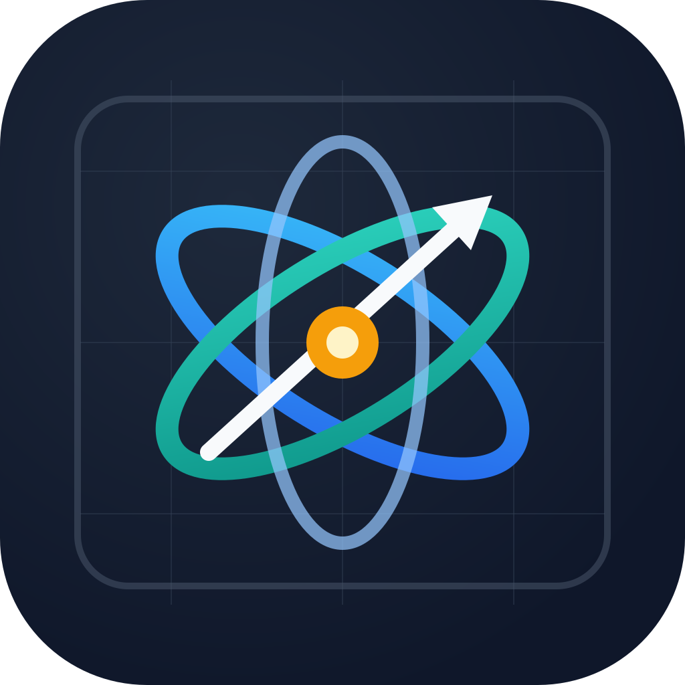

<div align="center">
  
  <h1>PhysBoard</h1>
  <p><strong>Bảng trắng tương tác dạy Toán &amp; Vật lý THPT — Hoạt động 100% Offline trên Windows &amp; Android</strong></p>
  <p>
    <a href="https://github.com/NeoGao-com/PhysBoard/releases/latest">
      
    </a>
  </p>
  <p>
    <em>Next.js 16 (Static Export) · React 19 · Tailwind CSS v4 · Electron · Capacitor Android</em>
  </p>
</div>

---

## Giới thiệu

**PhysBoard** là ứng dụng bảng trắng vector tương tác chuyên dụng cho giảng dạy **Toán học** và **Vật lý cấp THPT (Lớp 10, 11, 12 — GDPT 2018)**. Ứng dụng chạy hoàn toàn **100% Offline** không phụ thuộc trình duyệt web hay máy chủ mạng: dữ liệu bảng vẽ được lưu tự động trên thiết bị qua IndexedDB và hỗ trợ lưu/mở trực tiếp tệp `.phys.json`, xuất PNG, PDF và mã LaTeX TikZ.

---

## Tính năng nổi bật

### 1. Bảng vẽ Vector & Bút cảm ứng (Stylus-ready)
- **Hệ tọa độ Descartes vô hạn (`Oxy`):** Kéo pan, phóng to/thu nhỏ mượt mà (`Zoom 8–600`), lưới chấm (`#wb-dot-grid`), tối ưu cảm ứng & bút vẽ (`touch-action: none`, `overscroll-behavior: none`).
- **Công cụ vẽ & Quản lý điểm:** Bút thường, Bút máy thư pháp (`ink:fountain`), Tẩy tiếp xúc, bảng màu & độ dày nét linh hoạt, tô màu vùng/đỉnh đa giác; thanh chọn điểm trực quan (`Đổi tên`, `Ẩn/Hiện tên`, kiểu/cỡ chấm, cỡ tên mọi điểm, kéo di chuyển & nhấp đúp đổi tên nhãn).
- **Nhiều trang & Lưu trữ Offline:** Tạo nhiều trang bảng trong một phiên làm việc, tự động lưu cục bộ bằng IndexedDB (`y-indexeddb`), Lưu file `.phys.json` (`💾`) và Mở file (`📂`) 1 chạm.
- **Cửa sổ lệnh (`Ctrl+K`):** Tìm kiếm nhanh mọi công cụ, thí nghiệm và tùy chỉnh phím tắt cá nhân.

### 2. Bộ Công cụ Giảng dạy Vật lý THPT (`⚛ Vật lý ▾`)
- **15 Thí nghiệm Mô phỏng Tương tác (Lớp 10–11–12):**
  - **Lớp 10:** Chuyển động thẳng BĐĐ & Rơi tự do, Ném ngang/Ném xiên, Mặt phẳng nghiêng & Ma sát, Va chạm & Bảo toàn động lượng, Chuyển động tròn đều & Lực hướng tâm.
  - **Lớp 11:** Con lắc lò xo & Cơ năng, Con lắc đơn, Vòng tròn lượng giác & Tổng hợp dao động, Sóng dừng trên dây, Giao thoa sóng hai nguồn, Giao thoa ánh sáng Y-âng.
  - **Lớp 12:** Khí lý tưởng $p-V-T$, Cảm ứng điện từ Faraday/Len-xơ, Mạch RLC xoay chiều & Dao động ký, Quang điện ngoài & Phóng xạ hạt nhân.
- **Sơ đồ Vật lý Thông minh & Dụng cụ Đo:**
  - Mạch điện DC tương tác (nguồn $(E, r)$, biến trở, khóa `K` đóng/ngắt trực tiếp, Ampe kế/Vôn kế cập nhật tức thời).
  - Sơ đồ phân tích lực trên mặt phẳng ngang/nghiêng & Quang hình học 3 tia (Thấu kính hội tụ/phân kỳ, gương cầu lồi/lõm).
  - Thước thẳng (`cm/mm`), Thước đo góc `0°–180°`, Đồng hồ bấm giây có nút Lap.
- **Bảng thực hành & Bài giảng mẫu:** Ghi số liệu trực tiếp từ mô phỏng sang bảng thực hành, tính hồi quy tuyến tính $y = ax + b$ ($R^2$) và vẽ đồ thị lên `Axes2D`; 8 bài giảng mẫu 1 chạm; ~20 nhóm công thức SGK, 11 hằng số CODATA & đổi đơn vị nhanh.

### 3. Toán học 2D, 3D, Đồ thị & Soạn đề
- **Hình học phẳng 2D:** Điểm, đoạn/đường/tia/vectơ, đường tròn, đa giác, tam giác/tứ giác đặc biệt, dựng hình (đường cao, trung tuyến, phân giác, trọng tâm, trực tâm, đường tròn nội/ngoại tiếp), tự động vẽ ký hiệu vuông góc/bằng nhau.
- **Hình học không gian 3D:** Hộp chữ nhật, lập phương, lăng trụ, chóp, chóp cụt, trụ, nón, cầu, hệ trục `Oxyz`, điều khiển xoay quỹ đạo 3D, giao tuyến, thiết diện và tách mặt phẳng (hình thật).
- **Giải tích, Thống kê & Soạn đề (`Soạn đề`):** Vẽ đồ thị hàm số/bất phương trình có thanh trượt tham số, bảng biến thiên, cây xác suất, biểu đồ Venn/thống kê, trình soạn thảo đề A4 chuẩn.

---

## Cấu trúc dự án

```text
├── assets/                 # Logo gốc 1024x1024 & lớp adaptive icon
├── build/                  # Icon đóng gói Windows (icon.ico, icon.png)
├── electron/               # Main process Electron (main.js) cho bản desktop .exe
├── android/                # Dự án Capacitor Android (đã đồng bộ mipmap & web assets)
├── public/                 # Tài nguyên tĩnh (logo.png)
├── scripts/                # Script sinh bộ icon đa nền tảng (generate-icons.mjs)
├── server/                 # WebSocket LAN sync tùy chọn (chỉ bật khi NEXT_PUBLIC_ENABLE_SYNC=1)
├── src/
│   ├── app/                # Next.js App Router (layout.tsx, page.tsx, globals.css)
│   ├── components/         # UI primitives & toàn bộ thành phần bảng vẽ PhysBoard
│   ├── hooks/              # Hooks điều hướng canvas, undo/redo, lưu trữ offline
│   ├── lib/                # Bộ giải Toán 2D/3D, Đồ thị, Export, Mô phỏng Vật lý 10-12
│   └── types/              # Định nghĩa TypeScript cho Whiteboard & Physics
├── tests/e2e/              # Bộ kiểm thử Playwright E2E
├── capacitor.config.json   # Cấu hình Capacitor (com.physboard.app)
├── next.config.ts          # Next.js Static Export (out/, assetPrefix tương đối khi build)
└── package.json            # Scripts dev, check, electron-builder (.exe) & cap sync
```

---

## Cài đặt & Phát triển

Yêu cầu: **Node.js >= 20** (khuyến nghị Node 24).

```bash
# 1. Cài đặt dependencies
npm install

# 2. Chạy môi trường web phát triển (http://localhost:3000)
npm run dev

# 3. Kiểm tra Lint + TypeScript + Build Static Export (out/)
npm run check
```

### Kiểm thử E2E (Playwright)

```bash
# Chạy toàn bộ bộ test học thuật (Toán & Vật lý)
npx playwright test tests/e2e/tier4-academic/ --reporter=list
```

---

## Đóng gói Offline: Windows `.exe` & Android `.apk`

### Windows Portable (`.exe`) với Electron

```bash
# Chạy thử cửa sổ Desktop Electron trực tiếp từ bản build mới nhất
npm run electron:dev

# Đóng gói ra file chạy trực tiếp dist/PhysBoard 1.0.0.exe
npm run build:exe
```

### Android (`.apk`) với Capacitor

> Yêu cầu máy đã cài **Android Studio / Android SDK** (`ANDROID_HOME`) và JDK để biên dịch `.apk`.

```bash
# Build web (out/) và đồng bộ sang thư mục android/
npm run build:android

# Mở dự án bằng Android Studio để Build APK / Signed Bundle
npx cap open android

# Hoặc build Debug APK trực tiếp bằng Gradle (PowerShell)
cd android
.\gradlew assembleDebug
```

### Tạo lại bộ Icon đa nền tảng

```bash
npm run icons:generate
```
