

  
  <h1>PhysBoard v1.3.1</h1>
  

    <strong>Bảng trắng tương tác toàn diện dạy Toán · Vật lý · Hoá học THPT (GDPT 2018)</strong> 
    <em>Chạy mượt mà trên Windows (<code>.exe</code>), Android (<code>.apk</code>) &amp; Trình duyệt — Hoạt động 100% Offline, không cần đăng nhập</em>
  

  

    
    &nbsp;
    
    &nbsp;
    
  

---

## Mục lục

- [PhysBoard giải quyết vấn đề gì?](#physboard-giải-quyết-vấn-đề-gì)
- [1. Chuyên đề Hình học Phẳng 2D Động — Dựng hình chuẩn SGK & Ký hiệu tự động](#1-chuyên-đề-hình-học-phẳng-2d-động--dựng-hình-chuẩn-sgk--ký-hiệu-tự-động)
- [2. Chuyên đề Hình học Không gian 3D — Tự ẩn nét đứt, Thiết diện, Tách hình thật & Trải phẳng](#2-chuyên-đề-hình-học-không-gian-3d--tự-ẩn-nét-đứt-thiết-diện-tách-hình-thật--trải-phẳng)
- [3. Hệ trục Toạ độ Không gian Oxyz tương tác (Toán 12)](#3-hệ-trục-toạ-độ-không-gian-oxyz-tương-tác-toán-12)
- [4. Trình soạn Công thức Toán học, Giải PT / Hệ PT & Tô miền Tích phân](#4-trình-soạn-công-thức-toán-học-giải-pt--hệ-pt--tô-miền-tích-phân)
- [5. Hệ trục Oxy, Đồ thị Tham số, Bất phương trình, Cônic & Bảng biến thiên](#5-hệ-trục-oxy-đồ-thị-tham-số-bất-phương-trình-cônic--bảng-biến-thiên)
- [6. Thống kê, Tổ hợp – Xác suất, Sơ đồ cây Bayes, Biểu đồ Venn & Lý thuyết đồ thị](#6-thống-kê-tổ-hợp--xác-suất-sơ-đồ-cây-bayes-biểu-đồ-venn--lý-thuyết-đồ-thị)
- [7. Thư viện Vật thể Thực tế (Minh hoạ bài toán ứng dụng)](#7-thư-viện-vật-thể-thực-tế-minh-hoạ-bài-toán-ứng-dụng)
- [8. Bảng viết Vector, Bút Stylus chống tì tay, Tự nắn hình & Bút chỉ Laser](#8-bảng-viết-vector-bút-stylus-chống-tì-tay-tự-nắn-hình--bút-chỉ-laser)
- [9. Bộ 3 Ngăn kéo Công thức chuẩn GDPT 2018 (Toán · Vật lý · Hoá học & Bảng Tuần Hoàn 118 NT)](#9-bộ-3-ngăn-kéo-công-thức-chuẩn-gdpt-2018-toán--vật-lý--hoá-học--bảng-tuần-hoàn-118-nt)
- [10. Thí nghiệm Mô phỏng PhET Online & File HTML Offline Toàn màn hình](#10-thí-nghiệm-mô-phỏng-phet-online--file-html-offline-toàn-màn-hình)
- [11. Máy tính khoa học giả lập kiểu Casio fx-580VN X](#11-máy-tính-khoa-học-giả-lập-kiểu-casio-fx-580vn-x)
- [12. Cắt đề thi PDF / Ảnh (Ctrl+V), Sổ tay PhysBoard Notes, Nền bảng & Xuất PDF A4](#12-cắt-đề-thi-pdf--ảnh-ctrlv-sổ-tay-physboard-notes-nền-bảng--xuất-pdf-a4)
- [13. Công cụ Lớp học, Phím tắt Ctrl+K, Cài đặt Mô-đun, Tự cập nhật & Báo lỗi](#13-công-cụ-lớp-học-phím-tắt-ctrlk-cài-đặt-mô-đun-tự-cập-nhật--báo-lỗi)

---

## PhysBoard giải quyết vấn đề gì?

Khi giảng dạy **Toán – Vật lý – Hoá học**, giáo viên thường phải chuyển qua lại giữa rất nhiều công cụ rời rạc: một phần mềm viết bảng, phần mềm dựng hình phẳng & không gian, trình duyệt mở thí nghiệm PhET, phần mềm giả lập máy tính bỏ tay và các file PDF tra cứu công thức / bảng tuần hoàn.

**PhysBoard** hợp nhất trọn vẹn mọi công cụ đó vào **một không gian bảng trắng vector duy nhất**:
- **Vector sắc nét tuyệt đối:** Mọi nét mực, công thức LaTeX, hình học phẳng 2D và khối không gian 3D đều phóng to không bao giờ vỡ hình khi chiếu lên tivi hay máy chiếu lớp học.
- **100% Offline & Riêng tư:** Không cần đăng ký tài khoản, không cần mạng Internet khi lên lớp; toàn bộ sổ tay bài giảng, file PDF và mô phỏng lưu trực tiếp trên máy.
- **Tối ưu cho cả Máy tính & Máy tính bảng:** Hỗ trợ chuột / bảng vẽ điện tử Wacom trên **Windows (`.exe`)** và bút cảm ứng (**S Pen / Stylus**) có chế độ chống tì tay trên **Android (`.apk`)**.

---

## 1. Chuyên đề Hình học Phẳng 2D Động — Dựng hình chuẩn SGK & Ký hiệu tự động

Không chỉ là công cụ vẽ hình tĩnh, **PhysBoard tích hợp bộ nhân Hình học phẳng động (Dynamic Geometry)**: mọi điểm, đường và tâm được dựng đều giữ nguyên **ràng buộc toán học**. Khi giáo viên cầm chuột hoặc bút kéo thử một đỉnh tam giác di chuyển, toàn bộ đường cao, trung tuyến, trọng tâm, trực tâm, đường tròn ngoại tiếp, tiếp tuyến và giao điểm đều **tự động cập nhật chạy theo tức thì** — cực kỳ trực quan khi giảng bài quỹ tích, điểm cố định và cực trị hình học!

  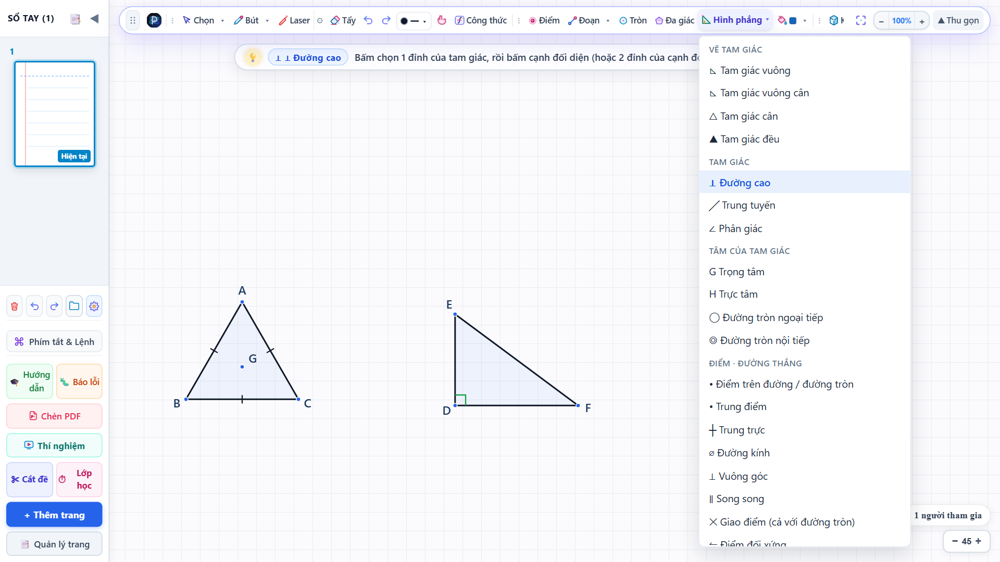

### Toàn bộ nhóm công cụ Hình học Phẳng 2D trong PhysBoard

| Nhóm chức năng | Các phép dựng chi tiết | Điểm nổi bật khi dạy trên lớp |
| :--- | :--- | :--- |
| **Đối tượng cơ bản** | • Chấm điểm tự đặt tên `A, B, C...` (`.` ) • Đoạn thẳng (`L`), Đường thẳng vô hạn (`Shift+L`), Tia (`R`), Vectơ có mũi tên (`Shift+V`) • Đường tròn từ tâm (`C`), Đa giác tự do (`Shift+P`) | Tự động bắt dính (snap) chính xác vào đỉnh, cạnh, đường tròn và giao điểm có sẵn |
| **Tam giác đặc biệt** | • **◺ Tam giác vuông** (`Shift+1`) • **◺ Tam giác vuông cân** (góc $90^\circ$ và hai góc $45^\circ$) • **△ Tam giác cân** • **▲ Tam giác đều** (`Shift+2`) | Chỉ cần bấm 2 đỉnh cạnh đáy/cạnh góc vuông là dựng xong ngay hình chuẩn kèm tên đỉnh |
| **Tứ giác đặc biệt** | • **▱ Hình bình hành** (chấm 3 đỉnh, đỉnh thứ 4 tự dựng) • **◇ Hình thoi** (4 cạnh bằng nhau) • **▭ Hình chữ nhật**, **□ Hình vuông** | Giữ nguyên tính chất song song / vuông góc / bằng nhau khi kéo giãn |
| **Đường & Tâm của Tam giác** | • **⊥ Đường cao** (`Alt+1`), **╱ Trung tuyến** (`Alt+2`), **∠ Phân giác** (`Alt+3`) • **G Trọng tâm** (`Alt+G`), **H Trực tâm** (`Alt+H`) • **◯ Đường tròn ngoại tiếp & tâm `O`** (`Alt+O`) • **◎ Đường tròn nội tiếp & tâm `I`** (`Alt+I`) | Bấm trực tiếp lên tam giác đang chọn (hoặc chọn 3 đỉnh) để dựng 1 chạm, không cần dựng thủ công nhiều bước |
| **Quan hệ Điểm – Đường – Đường tròn** | • **• Điểm trượt trên đường / đường tròn** (ràng buộc chạy dọc trên cạnh/cung) • **• Trung điểm** (`Alt+M`), **┼ Đường trung trực** (`Alt+T`) • **⊥ Đường vuông góc** (`Alt+V`), **∥ Đường song song** (`Alt+S`) • **⌀ Đường kính đường tròn** (bấm tâm + 1 điểm trên cung) • **✕ Giao điểm chính xác** (`Alt+X` — giữa đường thẳng & đường tròn) • **⇋ Điểm đối xứng** (qua tâm hoặc qua trục) • **∠ Dựng góc theo số đo nhập trước** ($30^\circ, 45^\circ, 60^\circ, 120^\circ\dots$) • **⟋ Tiếp tuyến đường tròn** (từ điểm nằm trên hoặc nằm ngoài đường tròn) | Phục vụ đầy đủ mọi dạng bài Hình học phẳng THCS (Lớp 8–9 ôn thi vào 10) và Hình học THPT |
| **Tự động gắn ký hiệu SGK & Tô miền** | • Công tắc **☑ Tự vẽ ký hiệu (ô vuông góc, gạch bằng nhau, cung góc)** ngay dưới menu Hình phẳng • **🪣 Tô màu vùng kín (`Flood Fill` - `G`)** chọn màu & độ trong suốt | Hình vẽ đẹp chuẩn sách giáo khoa ngay lập tức; có thể tắt ký hiệu tự động khi muốn hình trơn |

- **Tuỳ chỉnh Điểm & Nhãn tên chuyên sâu cho máy chiếu:** Khi bấm chọn một hoặc nhiều điểm, thanh ngữ cảnh phía dưới cho phép **✎ Đổi tên điểm** (hoặc nhấp đúp trực tiếp vào chữ), **🙈 Ẩn/Hiện tên điểm**, đổi kiểu điểm (**chấm tròn `•` / dấu `×` / vòng rỗng `○`**), chỉnh cỡ chấm và **tăng/giảm cỡ chữ tên mọi điểm (`A-` / `A+`)** để học sinh ngồi cuối lớp vẫn đọc rõ từng đỉnh.

---

## 2. Chuyên đề Hình học Không gian 3D — Tự ẩn nét đứt, Thiết diện, Tách hình thật & Trải phẳng

Hình học không gian Lớp 11–12 vốn là phần tốn nhiều thời gian vẽ hình và khó tưởng tượng nhất đối với học sinh. **PhysBoard xây dựng riêng một hệ thống Hình học Không gian 3D chuyên sâu** bám sát 100% chương trình Toán THPT Việt Nam:

  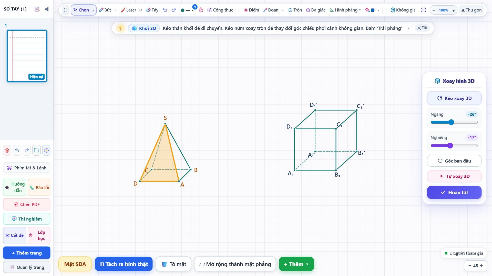

### 2.1. Kho Khối Đa diện & Khối Tròn xoay + Xoay 3D tự động đổi Nét đứt / Nét liền
- **Khối đa diện đầy đủ:** **Hình hộp chữ nhật**, **Hình lập phương**, **Lăng trụ đứng** *(đáy tam giác, ngũ giác, lục giác)*, **Hình chóp** *(chóp tam giác / tứ diện `S.ABC`, chóp tứ giác `S.ABCD`, ngũ giác, lục giác)*, **Hình chóp cụt đều** *(tam giác, tứ giác, lục giác)* và **Mặt phẳng `(P)`** biểu diễn trong không gian.
- **Khối tròn xoay:** **Hình trụ**, **Hình nón** (đỉnh $S$, bán kính $R$, đường sinh $l$) và **Hình cầu / Mặt cầu** (tâm $O$, đường tròn lớn xích đạo).
- **Thanh điều khiển `Xoay hình 3D` (`OrbitBar`) & Tự động khuất cạnh:**
  - Nút **Kéo xoay 3D** trực tiếp bằng chuột/bút hoặc chỉnh chính xác thanh trượt góc **Ngang (Azimuth)** và góc **Nghiêng (Elevation)**, nút **▶ Tự xoay 3D** tự động quay đều khối hình và nút **↺ Góc ban đầu**.
  - **Thuật toán ẩn nét tự động:** Ở bất kỳ góc xoay nào, các cạnh bị mặt trước che khuất sẽ **tự động chuyển sang nét đứt**, các cạnh nhìn thấy hiển thị **nét liền** đúng chuẩn quy tắc vẽ hình không gian SGK!

### 2.2. Chọn trực tiếp từng Mặt / từng Cạnh trên khối 3D
Chỉ cần bấm trực tiếp vào **một mặt bên/mặt đáy** (ví dụ `Mặt SDA`) hoặc **một cạnh** của khối 3D, PhysBoard làm nổi bật phần đó và mở ngay thanh thao tác chuyên biệt:
- **Khi chọn 1 Mặt:**
  - **◫ Tách ra hình thật:** Tách riêng mặt đang chọn ra ngay bên cạnh khối 3D thành **hình phẳng 2D đúng kích thước và góc thật** (cực kỳ lợi hại khi cần tính diện tích mặt bên, bán kính ngoại tiếp hay đường cao trong mặt phẳng đó!).
  - **🪣 Tô mặt / Bỏ tô mặt:** Đổ màu bán trong suốt làm nổi bật mặt phẳng cần xét.
  - **▱ Mở rộng thành mặt phẳng** & **🎯 Lấy tâm mặt**.
- **Khi chọn 1 Cạnh:**
  - **📏 Độ dài:** Hiện/ẩn nhãn độ dài cạnh trực tiếp trên hình.
  - **• Trung điểm:** Gắn chặt trung điểm vào cạnh (khi xoay khối 3D, trung điểm tự xoay theo!).
  - **• Điểm trên cạnh:** Tạo điểm trượt tự do dọc theo cạnh đó.
  - **⊥ Đường trung trực cạnh**.

### 2.3. Hơn 18 phép Dựng hình, Thiết diện, Khoảng cách & Góc trong Không gian
Menu **Không gian** tích hợp trọn bộ công cụ giải toán Hình không gian cổ điển & hiện đại:

  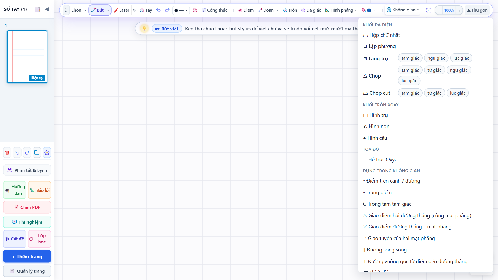

- **Giao điểm, Giao tuyến & Thiết diện:**
  - **✕ Giao điểm đường thẳng – mặt phẳng:** Chọn đường thẳng và 3 điểm xác định mặt phẳng → tự tìm giao điểm chính xác.
  - **⟋ Giao tuyến của hai mặt phẳng:** Bấm 3 điểm mặt thứ nhất (vd `S, A, C`) và 3 điểm mặt thứ hai (vd `S, B, D`) → tự dựng đường giao tuyến chung.
  - **▱ Dựng Thiết diện (Mặt cắt 3D):** Chọn mặt phẳng cắt qua 3 điểm → tự động tìm toàn bộ các đoạn giao tuyến khép kín với các mặt của khối đa diện và tô nổi bật đa giác thiết diện!
- **Khai triển & Tách hình:**
  - **◫ Trải phẳng đa diện (`Unfold Net 2D`):** Bấm 1 chạm để trải phẳng toàn bộ các mặt của hình chóp, lăng trụ, hình hộp ra bản vẽ khai triển 2D (giúp học sinh hiểu ngay công thức diện tích xung quanh, diện tích toàn phần và bài toán con kiến bò ngắn nhất trên bề mặt khối đa diện!).
  - **⧉ Tách mặt phẳng (hình thật):** Bấm 3 đỉnh bất kỳ để trích xuất mặt phẳng thật ra 2D.
- **Vuông góc, Khoảng cách, Góc & Mặt cầu ngoại tiếp:**
  - **⊥ Đường vuông góc từ điểm đến đường thẳng** trong không gian.
  - **⊥ Hình chiếu vuông góc của điểm lên mặt phẳng** (tìm chân đường cao $H$ hạ từ đỉnh hoặc từ điểm bất kỳ xuống mặt phẳng).
  - **📏 Khoảng cách từ điểm đến mặt phẳng** & **⟂ Đoạn vuông góc chung** của hai đường thẳng chéo nhau!
  - **∠ Đo góc 3D**, **∠ Góc giữa đường thẳng và mặt phẳng**, **∠ Góc giữa hai mặt phẳng (góc nhị diện)**.
  - **◯ Mặt cầu ngoại tiếp khối đa diện:** Bấm vào khối đa diện để tự xác định tâm $I$ và vẽ mặt cầu ngoại tiếp đi qua các đỉnh.
  - **⟶ Quy tắc hình hộp (Vectơ không gian Toán 12):** Bấm đỉnh gốc $A$ và 3 đỉnh kề $B, D, A'$ → tự dựng hệ vectơ $\vec{AB} + \vec{AD} + \vec{AA'} = \vec{AC'}$.

---

## 3. Hệ trục Toạ độ Không gian Oxyz tương tác (Toán 12)

Dành riêng cho chương **Phương pháp toạ độ trong không gian (Toán 12)**, hệ trục **`Oxyz`** trên PhysBoard là một không gian toạ độ 3 chiều sống động có thể xoay mọi góc nhìn bằng `OrbitBar`:

- Khi bấm chọn hệ trục `Oxyz`, thanh công cụ ngữ cảnh cung cấp 5 phép dựng toạ độ trực tiếp:
  1. **`+ Điểm M(x; y; z)`:** Nhập bộ ba toạ độ để đặt điểm trong không gian kèm các đường gióng toạ độ trực quan.
  2. **`+ Vectơ u⃗(x; y; z)`:** Biểu diễn vectơ toạ độ, vectơ pháp tuyến, vectơ chỉ phương trong không gian.
  3. **`◩ Mặt phẳng (P)`:** Dựng mặt phẳng từ phương trình tổng quát $Ax + By + Cz + D = 0$.
  4. **`⁄ Đường thẳng (d)`:** Dựng đường thẳng trong không gian đi qua điểm $M_0(x_0; y_0; z_0)$ có vectơ chỉ phương $\vec{u} = (a; b; c)$.
  5. **`◯ Mặt cầu (S)`:** Dựng mặt cầu từ toạ độ tâm $I(a; b; c)$ và bán kính $R$.

  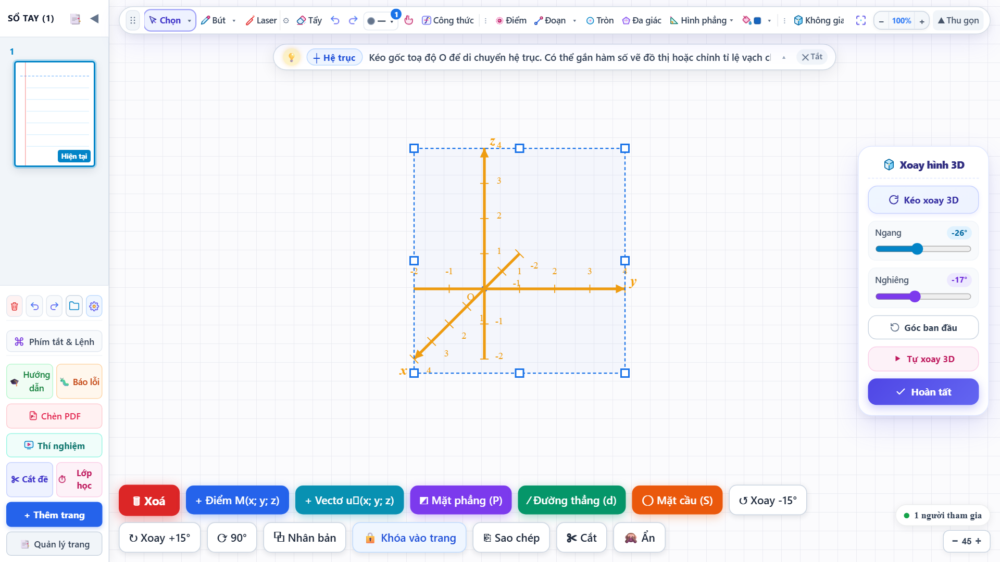

---

## 4. Trình soạn Công thức Toán học, Giải PT / Hệ PT & Tô miền Tích phân

Bấm công cụ **`∑ Công thức`** (`T`) rồi chạm vào vị trí bất kỳ trên bảng để mở khung soạn thảo Toán học trực quan (`MathLive` kết hợp `KaTeX`):

- **Bàn phím Toán học ảo 6 chuyên mục:** *Mẫu* (phân số, căn bậc $n$, trị tuyệt đối, tổ hợp, **hệ phương trình 2 ẩn / 3 ẩn**, logarit, vectơ $\vec{AB}$, cung $\widehat{AB}$, góc $\hat{A}$), *Quan hệ* (kể cả ký hiệu **chia hết `⋮`** và **không chia hết** chuẩn SGK Việt Nam), *Logic & Tập hợp*, *Giải tích* ($\lim, \sum, \int$), *Hình học*, *Ký tự Hy Lạp*.
- **4 Nút Hành động Thông minh ngay dưới ô nhập công thức:**
  1. **⚡ Giải PT / Hệ PT:** Tự động giải phương trình (bậc nhất, bậc hai, bậc ba, trùng phương...) hoặc hệ phương trình vừa nhập — trả về cả **nghiệm chính xác** (phân số / căn thức) lẫn giá trị xấp xỉ, cho phép chèn thẳng lời giải lên bảng!
  2. **📈 Vẽ đồ thị hàm này:** Tự động tạo hệ trục `Oxy` và vẽ ngay đồ thị của hàm số đang gõ.
  3. **📋 Tạo bảng biến thiên:** Tự tính đạo hàm, xét dấu, tìm cực trị và chèn ngay bảng biến thiên hoàn chỉnh của hàm số lên bảng.
  4. **∫ Tô miền tích phân:** Vẽ và tô màu miền phẳng giới hạn bởi đồ thị hàm số trên đoạn $[a; b]$ để minh hoạ bài toán tính diện tích / thể tích bằng tích phân (Toán 12).

  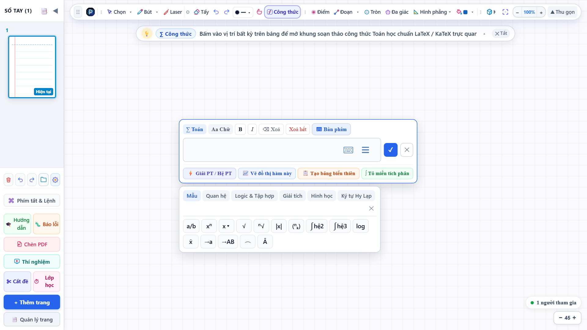

---

## 5. Hệ trục Oxy, Đồ thị Tham số, Bất phương trình, Cônic & Bảng biến thiên

Menu **Hàm số** và thanh ngữ cảnh của **Hệ trục `Oxy`** đáp ứng trọn vẹn mọi bài toán Đại số & Giải tích 10–11–12:

- **Vẽ đồ thị hàm số $y = f(x)$ kèm Thanh trượt tham số ($m, a, b$):** Kéo thanh trượt tham số để học sinh thấy đồ thị dịch chuyển, uốn cong và thay đổi số giao điểm trực tiếp theo $m$.
- **Phương trình ẩn $F(x, y) = 0$ & Các đường Cônic:** Vẽ chính xác đường thẳng tổng quát, đường tròn, **Elip**, **Parabol**, **Hypebol** (Chuyên đề Toán 10).
- **Bất phương trình & Hệ bất phương trình bậc nhất hai ẩn:** Tự động gạch bỏ / tô màu miền nghiệm trên mặt phẳng `Oxy` (phục vụ bài toán Quy hoạch tuyến tính Toán 10).
- **Đường cong tham số $x(t), y(t)$ & Biểu diễn dãy số $(u_n)$:** Hỗ trợ chuyên sâu cho dạy Chuyên đề và bồi dưỡng học sinh giỏi.
- **Chuyển đổi vạch chia nguyên ↔ vạch chia $\pi$ lượng giác:** Đổi nhãn trục hoành sang $-\pi, -\frac{\pi}{2}, \frac{\pi}{2}, \pi, 2\pi\dots$ chỉ bằng 1 cú nhấp khi dạy đồ thị $\sin x, \cos x, \tan x$ hoặc dao động điều hoà.
- **Bảng biến thiên, Bảng xét dấu & Đường tròn lượng giác:** Tự lập bảng biến thiên từ hàm số, bảng xét dấu từ biểu thức, khung bảng biến thiên trống để điền tay và đường tròn lượng giác chuẩn.

  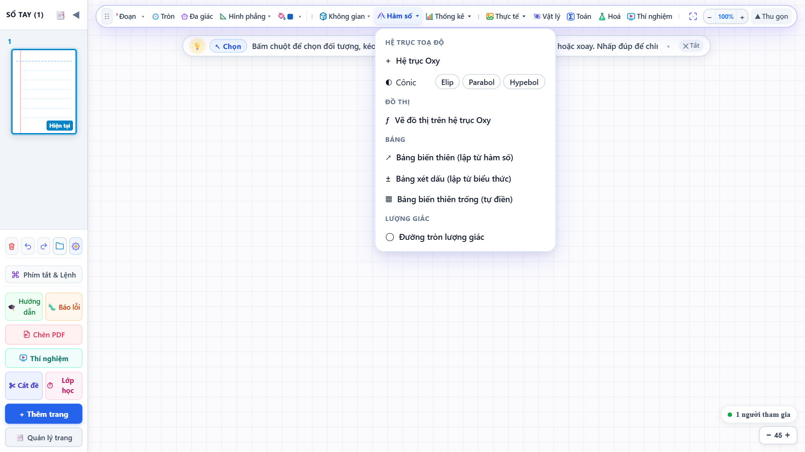

---

## 6. Thống kê, Tổ hợp – Xác suất, Sơ đồ cây Bayes, Biểu đồ Venn & Lý thuyết đồ thị

Thiết kế bám sát những đổi mới quan trọng nhất của chương trình **GDPT 2018**:

- **Biểu đồ Thống kê & Mẫu số liệu:** Tạo nhanh biểu đồ cột, biểu đồ quạt tròn, biểu đồ đường, tần số ghép nhóm để phân tích các số đặc trưng đo xu thế trung tâm và mức độ phân tán.
- **Quy tắc đếm:** Công cụ trực quan cho **Hoán vị ($P_n$)**, **Chỉnh hợp ($A_n^k$)** và **Tổ hợp ($C_n^k$)**.
- **Xác suất có điều kiện — Sơ đồ hình cây & Công thức Bayes:** Dựng nhanh **Sơ đồ hình cây** nhiều tầng kèm xác suất nhánh và khung tính **Xác suất toàn phần / Công thức Bayes ($P(B), P(A|B)$)** trọng tâm thi tốt nghiệp THPT mới.
- **Tập hợp & Lý thuyết đồ thị:** Vẽ nhanh **Biểu đồ Venn**, **Trục số biểu diễn giao/hợp/hiệu các khoảng – đoạn** (Toán 10) và **Đồ thị đỉnh – cạnh** cho chuyên đề Lý thuyết đồ thị (bài toán đường đi Euler, Hamilton, thuật toán tìm đường đi ngắn nhất — Chuyên đề Toán 11).

  

---

## 7. Thư viện Vật thể Thực tế (Minh hoạ bài toán ứng dụng)

Bài toán thực tế (tính chiều cao toà nhà, khoảng cách tàu thuyền, góc hạ từ máy bay, cái thang dựa tường, bóng cây dưới ánh nắng...) xuất hiện xuyên suốt từ Lớp 9 đến Lớp 12.

Kho **Thực tế** tích hợp hơn **100+ hình vẽ vật thể trực quan** (*Cây, Người, Toà nhà, Cột đèn, Cái thang, Thuyền, Máy bay, Mặt trời...*) cùng công cụ **trang trí đoạn đo kích thước, mặt đất, mặt nước** để ghép ngay vào hình tam giác/hệ trục chỉ trong vài giây.

  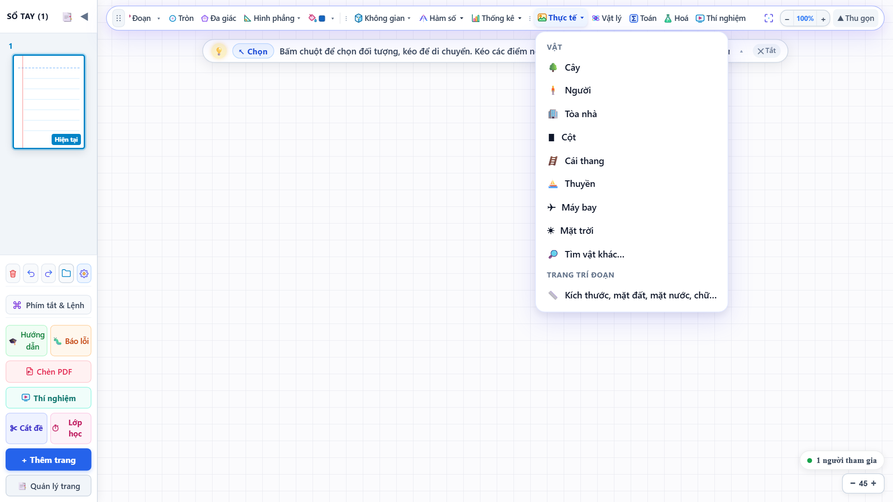

---

## 8. Bảng viết Vector, Bút Stylus chống tì tay, Tự nắn hình & Bút chỉ Laser

- **Đa dạng đầu bút viết bảng:** Bút tự do mượt mà (`P`), **Bút máy thư pháp nét thanh đậm** theo góc nghiêng/lực nhấn (`B`), Bút chì, Bút dạ quang (Highlighter), Bút nét đứt.
- **Tự nắn hình thông minh (`Ink-to-Shape`):** Vẽ tay một nét rồi giữ yên đầu bút `0,34 giây` để tự nắn thành đoạn thẳng, đường tròn, tam giác chuẩn xác.
- **Bút chỉ Laser (`Laser`):** Chọn kiểu chấm đỏ Laser hoặc vệt sáng huỳnh quang tự mờ dần khi giảng bài, tuỳ chỉnh màu và tốc độ mờ.
- **Chế độ Chỉ viết bằng bút Stylus (`Pen-Only Mode`):** Chống tì tay tuyệt đối trên máy tính bảng — tì lòng bàn tay thoải mái khi viết S Pen/Stylus, còn ngón tay chỉ dùng để kéo/zoom bảng.
- **Thanh bóng đèn hướng dẫn từng bước (`💡 Chỉ dẫn công cụ`):** Ngay dưới thanh công cụ luôn có dòng gợi ý thông minh hướng dẫn cụ thể thao tác tiếp theo cho công cụ bạn đang chọn (có thể thu gọn/tắt bất cứ lúc nào).
- **Khoá & Mở khoá từng khối độc lập:** Khoá cố định đề bài/hình vẽ mẫu vào trang (`🔒 Khóa vào trang`); khi cần mở lại có danh sách chọn mở khoá riêng từng khối ở góc dưới trái mà không ảnh hưởng các khối khác.

---

## 9. Bộ 3 Ngăn kéo Công thức chuẩn GDPT 2018 (Toán · Vật lý · Hoá học & Bảng Tuần Hoàn 118 NT)

Mỗi môn học có một ngăn kéo tra cứu riêng, hỗ trợ **tìm kiếm tiếng Việt không dấu** và nút **+ Chèn / + Chèn bảng** đưa công thức LaTeX sắc nét lên bảng trắng chỉ với 1 cú chạm:

### 9.1. Ngăn kéo Công thức Toán 10–11–12
Gồm 6 chủ đề trọng tâm: *Đại số & Phương trình* (Hằng đẳng thức, Vi-ét, BĐT Cô-si & Bunyakovsky, Mũ & Logarit), *Lượng giác*, *Giải tích* (Đạo hàm, Nguyên hàm, Tích phân), *Hình học 2D & `Oxy`*, *Không gian & `Oxyz`*, *Tổ hợp & Xác suất*.

  

### 9.2. Ngăn kéo Vật lý 10–11–12, Hằng số CODATA & Bộ đổi đơn vị
Gồm 3 thẻ: **Bảng Công thức SGK** (*Cơ học, Dao động & Sóng, Điện & Từ, Nhiệt & Khí lý tưởng, Quang & Hạt nhân*), **Bảng Hằng số Vật lý CODATA** ($g, c, h, e, N_A, k_B, R, G\dots$) và **Bộ Đổi đơn vị Vật lý nhanh** có ô nhập số trực tiếp, đảo chiều quy đổi và hiển thị rõ hệ số công thức (vd: `1 km/h = 1/3,6 m/s`).

  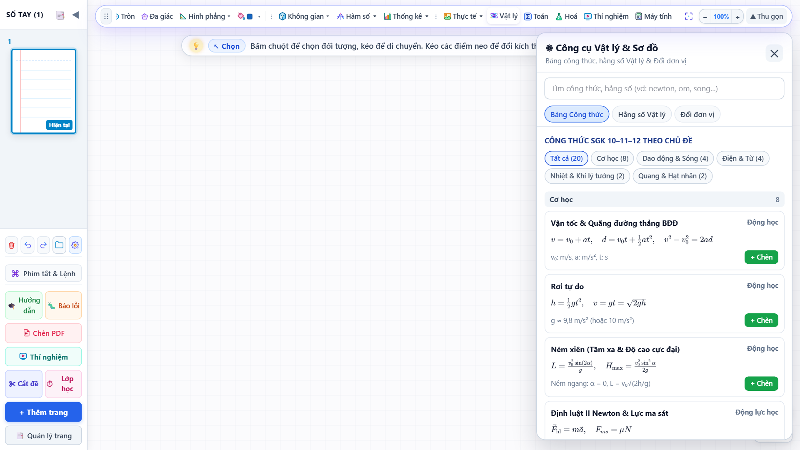

### 9.3. Ngăn kéo Hoá học 10–11–12 & Bảng Tuần Hoàn 118 nguyên tố tương tác
- **Công thức Hoá học:** *Mol & Dung dịch, Nguyên tử & Nhiệt hoá, Cân bằng & pH, Điện hoá & OXH-K, Hoá hữu cơ, Bảo toàn & Giải nhanh*.
- **Bảng Tuần Hoàn 118 nguyên tố tương tác:** Lọc theo nhóm hoặc tìm nhanh theo ký hiệu / tên / số hiệu $Z$; bấm vào ô nguyên tố bất kỳ để xem nguyên tử khối $M$, chu kỳ, độ âm điện, số oxi hoá và bấm **+ Chèn cấu hình e** (vd: `Fe (Z = 26): [Ar] 3d⁶ 4s²`) thẳng lên bảng.

  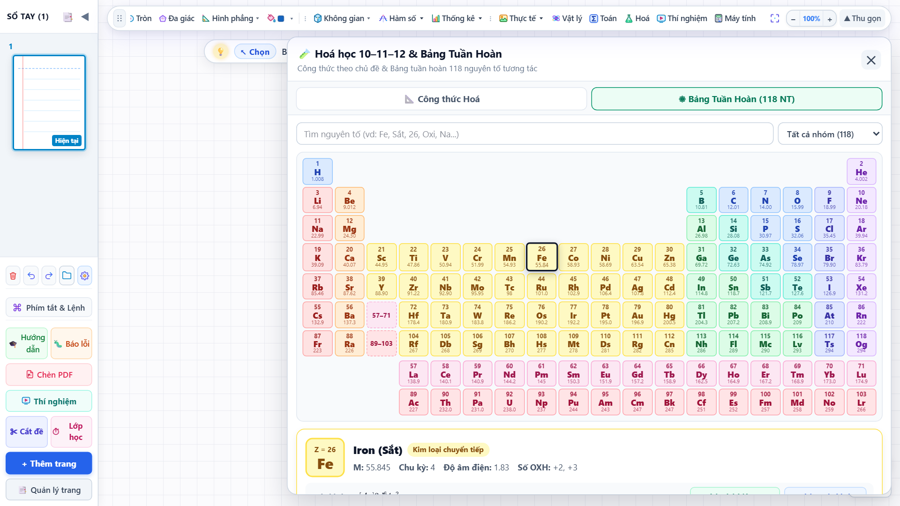

---

## 10. Thí nghiệm Mô phỏng PhET Online & File HTML Offline Toàn màn hình

- **Kho 28+ thí nghiệm PhET tiếng Việt chọn lọc & dán link bất kỳ:** Tự động mở toàn màn hình với gói đa ngôn ngữ `_all.html?locale=vi` (hiển thị tiếng Việt, tự chuyển sang tiếng Anh nếu bài chưa có bản dịch).
- **Kho File `.html` Offline (dạy 100% không cần mạng):** Nạp các file thí nghiệm HTML5 tải sẵn từ PhET vào bộ nhớ trong của ứng dụng để mở tức thì ở mọi phòng học không có Internet.
- **Thu nhỏ giữ trạng thái & Lớp kính vẽ chú thích (`✏ Vẽ chú thích`):** Chuyển đổi qua lại tức thì giữa màn hình thí nghiệm đang chạy và bảng trắng giải bài; bật lớp kính trong suốt để vẽ mũi tên lực, khoanh vùng chú thích đè trực tiếp lên mô phỏng.

  

---

## 11. Máy tính khoa học giả lập kiểu Casio fx-580VN X

Cửa sổ nổi máy tính bỏ túi ngay trên bảng trắng với bố cục phím bấm chuẩn **`fx-580VN X`** quen thuộc và màn hình **HiDPI Vector LCD** siêu nét — hỗ trợ hiển thị biểu thức tự nhiên, giải phương trình, tính đạo hàm/tích phân số, lưu biến nhớ `STO` để hướng dẫn học sinh bấm máy từng bước ngay trong tiết học.

  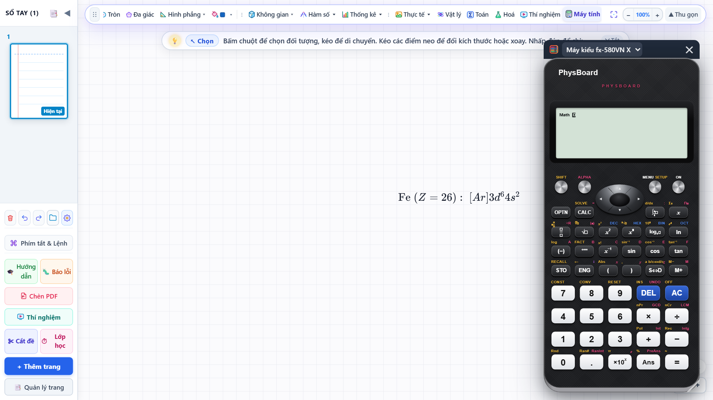

---

## 12. Cắt đề thi PDF / Ảnh (Ctrl+V), Sổ tay PhysBoard Notes, Nền bảng & Xuất PDF A4

### 12.1. Cắt câu hỏi đề thi siêu tốc (`✂ Cắt đề`)
Kéo thả file **PDF / Ảnh chụp đề thi** hoặc chụp màn hình rồi nhấn **`Ctrl+V`** để dán trực tiếp → khoanh vùng câu hỏi → bấm **✂ Cắt & Ghim lên bảng** (tự động khoá đề bài vào trang để viết lời giải không bị xê dịch; có nút **Cắt & Cắt tiếp câu khác** để cắt liên hoàn nhiều câu).

  

### 12.2. Quản lý nhiều Sổ tay (`PhysBoard Notes`), Nền bảng, Xuất PDF & Sao lưu
- **Tổ chức bài giảng khoa học:** Tạo nhiều bảng/sổ tay riêng theo từng lớp và chuyên đề, gom nhóm theo **Thư mục**, tìm kiếm nhanh, có **Thùng rác** khôi phục bài xoá nhầm và quản lý trang dạng lưới trực quan.
- **Khổ giấy & Nền bảng linh hoạt:** Chọn **Bảng vô hạn** hoặc **Khổ trang A4** chuẩn in ấn; đổi nền giấy ô ly vuông, chấm bi, dòng kẻ ngang, giấy trắng hoặc **nền bảng đen / bảng xanh phấn trắng** dịu mắt.
- **Xuất tài liệu PDF / PNG thông minh:** Tuỳ chọn xuất trang hiện tại, toàn bộ sổ tay hoặc dải trang bất kỳ (vd `1-3, 5`), có chế độ **tự chuyển về nền giấy trắng khi xuất PDF** để học sinh in ra rõ nét, tiết kiệm mực.
- **💾 Sao lưu & Khôi phục trọn gói (`.physbackup.json`):** Đóng gói toàn bộ các sổ tay, trang viết và PDF thành 1 file duy nhất để dự phòng hoặc chuyển dữ liệu sang thiết bị khác.

  

---

## 13. Công cụ Lớp học, Phím tắt Ctrl+K, Cài đặt Mô-đun, Tự cập nhật & Báo lỗi

### 13.1. Công cụ Lớp học (`⏱ Lớp học`)
Gồm **Đồng hồ đếm ngược** làm bài tập (`1p, 3p, 5p, 10p, 15p...` kèm chuông báo hết giờ) và **🎲 Gọi tên học sinh ngẫu nhiên** không trùng lặp trong cùng lượt quay.

  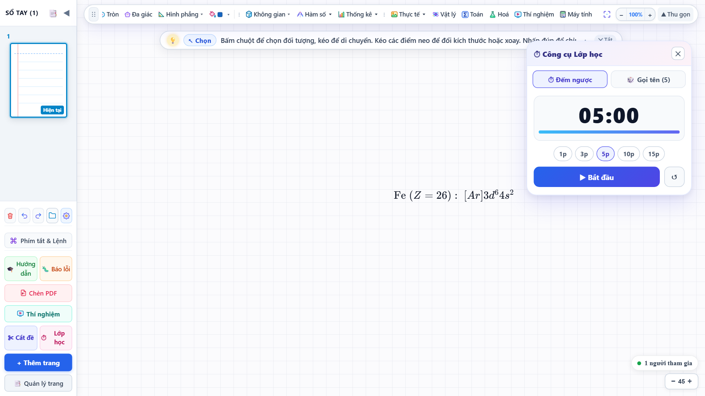

### 13.2. Cửa sổ Lệnh nhanh & Gán phím tắt cá nhân (`Ctrl+K`)
Bấm **`Ctrl+K`** để tra cứu mọi chức năng bằng tiếng Việt không dấu và tự gán lại phím tắt bàn phím theo thói quen giảng dạy của riêng bạn.

  

### 13.3. Cài đặt Mô-đun (Lego), Tự động cập nhật & Báo lỗi trực tiếp
- **Bố cục Mô-đun (Lego) & Ẩn/Hiện Công cụ:** Tự do bật/tắt từng nút công cụ theo môn dạy để giao diện luôn thoáng gọn.
- **Tự động cập nhật 1 chạm:** Kiểm tra bản mới, tải ngầm hiển thị `%` tiến trình và cài đặt trực tiếp trên cả **Windows (`.exe`)** và **Android (`.apk`)**.
- **🐛 Báo lỗi & Góp ý ngay trong ứng dụng:** Gửi nhanh phản hồi kèm thông số phiên bản qua **GitHub Issues**, **Email** hoặc **Copy báo cáo** chỉ trong vài giây.

  
  &nbsp;
  

---

  Phát hành miễn phí theo giấy phép MIT · Tải phiên bản mới nhất tại <a href="https://github.com/NeoGao-com/PhysBoard/releases">PhysBoard Releases</a>

